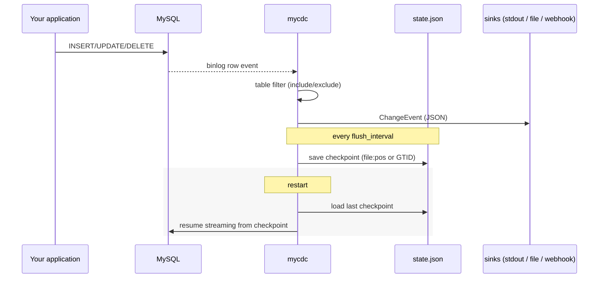

# mycdc

A change data capture (CDC) CLI for MySQL 5.7 through 9.x. mycdc streams
row-level `INSERT`/`UPDATE`/`DELETE` events out of a MySQL server's binlog
(the same replication protocol real replicas use) and delivers them to
stdout, a local file, and/or a webhook -- checkpointing its progress so a
restart resumes instead of re-scanning.

For the architecture and the reasoning behind it, see
[docs/DESIGN.md](docs/DESIGN.md).



## Requirements

- **MySQL 5.7-9.x** with `binlog_format=ROW`.
- A MySQL user with `REPLICATION SLAVE`, `REPLICATION CLIENT`, and
  `SELECT` (on whatever you plan to capture) privileges.
- **Go 1.23+** to build from source.

## Install / build

```sh
git clone https://github.com/ChaosHour/mycdc.git && cd mycdc
go build -o mycdc .
./mycdc version
```

## Quick start

**1. Prepare MySQL.** Confirm row-based binlogging is on, then create a
capture user:

```sql
SHOW VARIABLES LIKE 'binlog_format';  -- must read ROW

CREATE USER 'mycdc'@'%' IDENTIFIED BY 'change-me';
GRANT REPLICATION SLAVE, REPLICATION CLIENT, SELECT ON *.* TO 'mycdc'@'%';
FLUSH PRIVILEGES;
```

(`SELECT ON *.*` is the simplest grant; scope it to specific databases if
you'd rather not grant it server-wide.)

**2. Scaffold a config:**

```sh
./mycdc init --format yaml -o mycdc.yaml
```

This writes a fully-formed, ready-to-edit config (see
[Config reference](#config-reference) below). Open it and fill in your
host, user, and a unique `server_id`; `--format json` produces the JSON
equivalent instead. Prefer environment variables for secrets:

```sh
export MYCDC_MYSQL_PASSWORD='change-me'
```

**3. Validate it:**

```sh
./mycdc validate -c mycdc.yaml
```

```
mycdc.yaml is valid
  pipeline: my-pipeline
  source:   127.0.0.1:3306 (server_id 1001)
  sinks:    1
    - stdout
```

**4. Run it:**

```sh
./mycdc run -c mycdc.yaml
```

mycdc connects, registers as a replication client, and streams events as
they happen. With the default `stdout`/`pretty` sink from `init`, a write
to an included table looks like this (captured live against a real MySQL
8.0 server during development -- see
[docs/DESIGN.md §6](docs/DESIGN.md#6-what-was-actually-tested)):

```
insert sakila.actor  (<none>)
  after : {"actor_id":201,"first_name":"CLAUDE","last_name":"CODE","last_update":"2026-07-28 19:46:08"}
update sakila.actor  (binlog.000059:1315)
  before: {"actor_id":201,"first_name":"CLAUDE","last_name":"CODE","last_update":"2026-07-28 19:46:08"}
  after : {"actor_id":201,"first_name":"CLAUDE","last_name":"AGENT","last_update":"2026-07-28 19:46:09"}
delete sakila.actor  (binlog.000059:1646)
  before: {"actor_id":201,"first_name":"CLAUDE","last_name":"AGENT","last_update":"2026-07-28 19:46:09"}
```

Stop it with `Ctrl-C` (`SIGINT`) or `SIGTERM`; mycdc flushes its
checkpoint and shuts down cleanly. Logs go to **stderr**; event data goes
to **stdout** (when using the stdout sink) -- so you can safely pipe
`mycdc run`'s stdout into another program without log lines mixed in.

**5. Check progress at any time** (even while `run` is active elsewhere,
or after it has stopped):

```sh
./mycdc status -c mycdc.yaml
```

```
pipeline:   my-pipeline
state file: ./state/my-pipeline.json
position:   binlog.000059:1948
```

## Config reference

mycdc accepts **YAML or JSON** -- pick whichever your team already tools
around; `Load` chooses the parser from the file extension (`.yaml`/`.yml`
vs `.json`). Every field below works identically in both; see
[configs/example.yaml](configs/example.yaml) and
[configs/example.json](configs/example.json) for complete, heavily
commented, side-by-side examples.

| Field | Required | Default | Notes |
|---|---|---|---|
| `pipeline` | yes | -- | Stable name; must match `^[A-Za-z0-9][A-Za-z0-9_-]*$`. Used as the checkpoint key and stamped onto every event. |
| `mysql.host` | yes | -- | |
| `mysql.port` | yes | -- | |
| `mysql.user` | yes | -- | |
| `mysql.password` | no | `""` | Supports `${VAR}` expansion from the environment. |
| `mysql.server_id` | yes | -- | Must be unique among all replication clients on the source server, including real replicas. |
| `mysql.flavor` | no | `mysql` | `mysql` or `mariadb`. |
| `mysql.charset` | no | `utf8mb4` | |
| `mysql.heartbeat_period` | no | `30s` | |
| `mysql.read_timeout` | no | `90s` | |
| `tables.include` | no | (all tables) | Glob `database.table` patterns, e.g. `"shop.orders"`, `"shop.*"`. |
| `tables.exclude` | no | (none) | Same syntax; always wins over `include`. |
| `state.path` | yes | -- | JSON checkpoint file. Parent directories are created automatically. |
| `state.flush_interval` | no | `5s` | How often the checkpoint is persisted. |
| `sinks` | yes (≥1) | -- | List of sink configs; see below. |
| `log_level` | no | `info` | `debug`, `info`, `warn`, or `error`. Logs go to stderr. |

**Sink types** (a pipeline can list several):

| Type | Fields | Notes |
|---|---|---|
| `stdout` | `format`: `json` (default) or `pretty` | |
| `file` | `path` (required) | Appends newline-delimited JSON (JSONL/NDJSON); creates parent dirs. |
| `webhook` | `url` (required), `headers`, `timeout` (default `10s`), `max_retries` (default `3`), `retry_backoff` (default `500ms`) | POSTs each event's JSON body. 5xx and transport errors are retried with linear backoff; 4xx is treated as permanent (not retried). |

Any duration field (`heartbeat_period`, `read_timeout`, `flush_interval`,
webhook `timeout`/`retry_backoff`) accepts a Go duration string like
`"30s"`, `"5m"`, `"1h30m"` in both YAML and JSON.

## Worked examples

### Multiple sinks at once

```yaml
sinks:
  - type: stdout
    format: pretty          # for watching it live in a terminal
  - type: file
    path: ./out/orders.jsonl  # durable local log
  - type: webhook
    url: https://internal.example.com/hooks/cdc
    headers:
      Authorization: "Bearer ${MYCDC_WEBHOOK_TOKEN}"
```

All three receive every event that passes the table filter; one being
slow or down doesn't block the others (see
[docs/DESIGN.md](docs/DESIGN.md#delivery-fan-out-and-failure-isolation)).

### Capturing everything except one noisy table

```yaml
tables:
  exclude:
    - "shop.audit_log"
```

Leaving `include` empty means "every table"; `exclude` still applies.

### Capturing only a couple of tables across databases

```yaml
tables:
  include:
    - "shop.orders"
    - "billing.invoices"
```

### Piping stdout JSON into another tool

```sh
./mycdc run -c mycdc.yaml | jq 'select(.operation == "delete")'
```

Since logs are on stderr and events are on stdout (in `json` format --
`pretty` is for humans, not machines), this is a safe pipeline.

### Running two pipelines against the same server

Give each its own `pipeline` name, `server_id`, and `state.path`:

```sh
./mycdc run -c orders.yaml &
./mycdc run -c inventory.yaml &
```

## CLI reference

| Command | Purpose |
|---|---|
| `mycdc init [--format yaml\|json] [-o path] [--force]` | Scaffold a ready-to-edit config file. |
| `mycdc validate -c <path>` | Parse and validate a config without connecting to MySQL. |
| `mycdc run -c <path>` | Start capturing. Runs until `SIGINT`/`SIGTERM`. |
| `mycdc status -c <path>` | Print the last saved checkpoint for the pipeline. |
| `mycdc version` | Print the mycdc version. |

## Delivery guarantees, in one paragraph

mycdc is **at-least-once**: checkpoints are flushed on a timer
(`state.flush_interval`), not per event, and binlog replication only
reports a safely-resumable position at transaction boundaries anyway. A
crash can cause the last few seconds of already-delivered events to be
redelivered on restart; it cannot cause events to be silently dropped. If
a downstream consumer needs exactly-once semantics, dedupe on
`(database, table, position)` or a primary key from the row payload. Full
reasoning: [docs/DESIGN.md §3](docs/DESIGN.md#checkpointing-what-position-means-for-a-binlog-source).

## Troubleshooting

| Symptom | Likely cause |
|---|---|
| `mysql source: connecting to ...: ERROR 1045` | Bad user/password, or the user lacks `REPLICATION SLAVE`/`REPLICATION CLIENT`. |
| Connects, then immediately errors about binlog format | `binlog_format` isn't `ROW`. Run `SET GLOBAL binlog_format = 'ROW'` (and update `my.cnf` to persist it). |
| `Error 1236: ... requested master event position ... doesn't exist` | The saved checkpoint's binlog file has been purged by MySQL (`expire_logs_days` / `binlog_expire_logs_seconds`). Delete the pipeline's `state.path` file to restart from the current position (you will lose everything between the old checkpoint and now). |
| A second pipeline against the same server won't connect / replication errors | `server_id` collides with another replication client (another mycdc pipeline, or a real replica). Pick a unique one. |
| Events for a table never show up | Check `tables.include`/`tables.exclude` with `mycdc validate` (it prints the loaded config), and confirm the table is actually being written to on the primary you pointed mycdc at, not a replica. |
| `run` exits instantly with a validation error | `mycdc run` validates the full config, including MySQL connection *shape* (not reachability) and sink config, before doing anything else -- fix the reported field(s) and retry. |

## Development

```sh
go build ./...
go vet ./...
go test ./... -race -cover
```

The test suite (all packages, `-race` clean) covers config parsing and
validation, table filtering, checkpoint persistence, all three sinks
(including webhook retry/backoff via `httptest.Server`), the pipeline
orchestrator (via fake source/sink/state implementations), MySQL row-event
conversion (built from the replication library's own exported structs, no
live server needed), and every CLI command. What isn't (and can't
sensibly be) covered by an automated unit test -- actually streaming from
a live binlog -- was instead verified by hand against real MySQL 8.0
containers; see
[docs/DESIGN.md §6](docs/DESIGN.md#6-what-was-actually-tested) for exactly
what was exercised.

Project layout, the reasoning behind each package boundary, delivery
guarantees, and what's deliberately out of scope for v1: see
[docs/DESIGN.md](docs/DESIGN.md).
