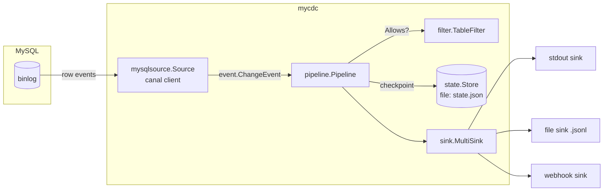

# mycdc: Design

mycdc is a change data capture (CDC) command-line tool for MySQL 5.7
through 9.x. It streams row-level `INSERT`/`UPDATE`/`DELETE` events out of
a MySQL server's binlog and delivers them to one or more sinks (stdout, a
local file, or a webhook), checkpointing its progress so a restart resumes
instead of re-scanning.

This document explains what building that takes, the decisions behind the
architecture, and the tradeoffs. For "how do I use it," see
[README.md](../README.md).

## 1. What CDC actually requires

Any CDC tool, regardless of language or target database, needs to solve
five problems:

1. **Get a durable, ordered stream of row-level changes** out of the
   source database, without hammering it with polling queries and without
   missing deletes.
2. **Represent a change** in a shape that's independent of the source
   database's wire format, so downstream consumers don't need to know
   anything about MySQL specifically.
3. **Decide what to keep** -- most pipelines care about a handful of
   tables, not the whole server, including its own internal tables and
   every other application sharing the instance.
4. **Deliver changes somewhere**, ideally to several places (a log for
   debugging, a durable file, a service that reacts to them) without one
   slow destination blocking the others.
5. **Remember where it left off**, so a restart (deploy, crash, planned
   maintenance) doesn't have to choose between re-processing the entire
   history or silently losing changes.

Everything in mycdc's architecture is one of these five concerns, kept in
its own package so each is independently testable and independently
replaceable.

## 2. Why binlog replication, not polling

MySQL CDC tools generally take one of two approaches:

- **Query-based ("poll a cursor column")**: periodically `SELECT` rows
  where `updated_at > last_seen`. Simple, needs no special privileges, but
  structurally can't see deletes (unless the app does soft deletes) and
  adds recurring query load proportional to how fresh you want the data.
- **Log-based (binlog replication)**: register as a replica and read the
  same row-change stream MySQL sends to real replicas. Sees every insert,
  update, and delete, in commit order, with no added query load on the
  tables being captured. This is how Debezium, Maxwell, and Alibaba's
  canal all work.

mycdc uses log-based capture, via
[`go-mysql-org/go-mysql`](https://github.com/go-mysql-org/go-mysql)'s
`canal` package, which implements the MySQL replication protocol
(`COM_BINLOG_DUMP` / `COM_BINLOG_DUMP_GTID`) and binlog row-event
decoding in pure Go. This is the same library family used by production
tools like [go-mysql-elasticsearch](https://github.com/go-mysql-org/go-mysql-elasticsearch)
and [Alibaba's canal](https://github.com/alibaba/canal); mycdc adds the
pipeline orchestration, config, sinks, and checkpointing around it.

**What this requires on the MySQL side:**

- `binlog_format = ROW` (statement-based and mixed formats don't carry
  the actual row values mycdc needs).
- A user with `REPLICATION SLAVE` and `REPLICATION CLIENT` privileges
  (and `SELECT` on the captured tables/databases, so mycdc can look up
  table schema to name binlog columns).
- A `server_id` for mycdc that's unique among every replication client
  attached to that server, real replicas included.

**Version support:** MySQL 5.7 through 9.x all speak the same row-based
binlog protocol mycdc depends on (GTIDs, introduced in 5.6, are supported
throughout; the wire protocol has not changed in an incompatible way
across this range). MariaDB is accepted as a `flavor` setting because its
binlog protocol descends from the same lineage, but it is not part of the
tested support matrix.

## 3. Architecture



Each box is its own package under `internal/`, talking to its neighbors
only through a small interface:

| Package | Responsibility | Depends on |
|---|---|---|
| `internal/event` | The canonical `ChangeEvent` shape every source produces and every sink consumes. | nothing |
| `internal/config` | Load/validate a pipeline config from YAML or JSON. | `internal/event` (for `Position` in defaults) |
| `internal/filter` | `database.table` glob include/exclude matching. | nothing |
| `internal/state` | `Store` interface + a file-backed implementation; atomic checkpoint persistence. | `internal/event` |
| `internal/sink` | `Sink` interface + stdout/file/webhook implementations and a fan-out `MultiSink`. | `internal/config`, `internal/event` |
| `internal/source` | The `Source` interface every capture backend implements. | `internal/event` |
| `internal/source/mysql` | The MySQL binlog `Source`, wrapping `canal`. | `internal/config`, `internal/event`, `internal/source` |
| `internal/pipeline` | Wires a `Source`, `TableFilter`, `Sink`, and `Store` together; owns the run loop, filtering, and periodic checkpointing. | all of the above |
| `cmd` | The Cobra CLI (`init`, `validate`, `run`, `status`, `version`). | `internal/*` |

Nothing outside `internal/source/mysql` and `cmd` knows MySQL exists.
Swapping in a Postgres or SQL Server source later means implementing
`source.Source` -- `Run(ctx, from Position, handler EventHandler) error`
-- and does not touch `pipeline`, `sink`, `state`, or `filter` at all.

### The event model

```go
type ChangeEvent struct {
    Pipeline  string
    Database, Table string
    Operation Operation // insert | update | delete
    Before, After map[string]any // column name -> value
    Position  Position // resume-here marker
    Timestamp time.Time
}
```

`Before` is nil for inserts, `After` is nil for deletes, and both are
populated for updates -- deliberately mirroring what a binlog row event
actually contains, rather than inventing a diff format. Column values keep
their native Go type as decoded by the MySQL client library (`int64`,
`string`, `time.Time`-ish strings, `[]byte` for blobs, etc.), then get
JSON-encoded by the sinks; if a sink needs a specific target-side type, it
converts from this map, keeping that concern out of the source.

### Checkpointing: what "position" means for a binlog source

Binlog replication only reports a resumable position at transaction and
statement boundaries (`XID` at commit, binlog file rotation, DDL) -- never
mid-transaction. mycdc's MySQL source therefore stamps every row event
with the position as of the *start* of its transaction: "if the process
dies right now, resuming from this position will re-deliver this
transaction's rows." The pipeline advances the saved checkpoint on a
timer (`state.flush_interval`, default 5s), not on every event, since
`fsync`-ing a checkpoint file per row would cap throughput at disk-sync
speed.

The consequence, stated plainly: **mycdc gives at-least-once delivery**,
not exactly-once. After an unclean restart, the last few seconds of
already-delivered events may be redelivered. This was verified directly
(see [Section 6](#6-what-was-actually-tested)): killing mycdc mid-stream
and restarting it re-emitted the last transaction's row exactly once more,
then continued correctly from there. Sinks that need exactly-once
semantics should dedupe downstream using `(database, table, position)` or
a primary key from the row payload -- mycdc does not invent a global
sequence number, since `Position` already serves as one per pipeline.

The checkpoint advances even for events the table filter rejects: it
tracks "how far into the binlog have we processed," not "how much did we
deliver." If it only advanced on delivered events, excluding a busy table
would pin the checkpoint in place and turn every restart into an
ever-growing re-scan.

### Why `Position` carries both file/offset and GTID

MySQL replicas resume from either a `(binlog file, byte offset)` pair or a
GTID set, depending on whether `gtid_mode` is enabled on the source
server. mycdc's `Position` carries both, and the MySQL source resumes with
whichever one it has: GTID a set if present (`StartFromGTID`), otherwise
file/offset (`RunFrom`). On a completely fresh pipeline (`from` is the
zero `Position`, no checkpoint saved yet), it does not start from the
first available binlog -- it fetches the server's *current* position and
starts from there, so turning on a new pipeline never triggers a replay
of the server's entire retained binlog history.

### Config: one schema, two serializations

The `Config` struct has both `yaml` and `json` struct tags; `Load` picks
the decoder from the file extension (`.yaml`/`.yml` vs `.json`). Durations
(`heartbeat_period`, `flush_interval`, webhook `timeout`/`retry_backoff`)
use a small `config.Duration` wrapper implementing both `UnmarshalJSON`
and YAML's native `UnmarshalYAML(*yaml.Node)`, so `"30s"` works
identically in either format instead of forcing JSON users to write raw
nanoseconds. `${VAR}` references in `password`, webhook `url`, and
webhook `headers` are expanded from the environment at load time -- an
unset variable is left as the literal `${VAR}` text rather than silently
becoming an empty string, so a missing secret fails loudly instead of
connecting with a blank password.

### Delivery fan-out and failure isolation

A pipeline can list several sinks; `sink.NewAll` wraps them in a
`MultiSink` that writes to every one of them and joins whatever errors
come back (`errors.Join`), rather than stopping at the first failure. A
webhook endpoint being down does not stop the file sink from getting
written. If *any* sink fails, though, the pipeline treats the event as
undelivered and does not advance the checkpoint past it -- see
[`internal/pipeline/pipeline.go`](../internal/pipeline/pipeline.go).

## 4. Extensibility

Adding a new sink means implementing three methods
(`Write(ctx, event.ChangeEvent) error`, `Close() error`) and registering a
`case` in `sink.New`'s type switch -- see
[`internal/sink/webhook.go`](../internal/sink/webhook.go) for the shape of
a real one, including retry/backoff. Adding a new source means
implementing `source.Source`'s `Run`/`Close` and translating whatever the
upstream native change format is into `event.ChangeEvent` -- see
[`internal/source/mysql/convert.go`](../internal/source/mysql/convert.go)
for the pattern: keep the translation as a pure function taking the
native record and returning `[]event.ChangeEvent`, so it's unit-testable
without a live connection.

## 5. Testing strategy

Binlog replication itself can't be meaningfully unit tested without a
running MySQL server speaking the real protocol, so the test suite draws
a hard line: **anything that is pure logic gets a unit test with no
network or filesystem dependency beyond `t.TempDir()`; anything that
requires a live server was instead verified by hand against real MySQL
containers** (Section 6) and is called out as such rather than faked.

What's covered by the automated suite (`go test ./...`, all packages,
`-race` clean):

- **Config** (`internal/config`): YAML and JSON produce identical parsed
  structs from equivalent input; every default; `${VAR}` expansion,
  including the "leave unset vars alone" behavior; every validation
  error path.
- **Filter** (`internal/filter`): glob include/exclude semantics,
  exclude-wins-over-include, wildcard database/table patterns.
- **State** (`internal/state`): save/load round trip, atomic-write
  behavior (no temp files left behind, corrupt file detected, concurrent
  saves don't race or corrupt the file), multiple pipelines sharing one
  file.
- **Sinks** (`internal/sink`): stdout JSON/pretty formats; file sink
  appends across process restarts; webhook retry-on-5xx,
  no-retry-on-4xx, respects context cancellation mid-backoff (via
  `httptest.Server`, no real network); multi-sink fan-out and partial
  failure.
- **Pipeline** (`internal/pipeline`): filtering-but-still-checkpointing,
  periodic checkpoint flushing, checkpoint loaded and passed to the
  source on start, context-cancellation shutdown, a sink error stopping
  the run -- all against a fake `Source`/`Sink`/`Store`, no I/O.
- **MySQL row-event conversion** (`internal/source/mysql`): insert/
  update/delete conversion including multi-row events, the update
  before/after pairing, malformed/truncated events, and the event-handler
  adapter's position-tracking state machine (`OnRotate`/`OnPosSynced`
  advancing the position later reads pick up) -- built directly from
  `canal`'s exported structs (`canal.RowsEvent`, `schema.Table`), no
  server needed.
- **CLI** (`cmd`): every subcommand, via Cobra's `SetArgs`/`SetOut`
  pattern -- `init` produces a config that `validate` accepts; `run` and
  `status` fail fast on a bad config path *before* attempting any network
  connection (verified by asserting the error surfaces without a
  reachable MySQL server present).

## 6. What was actually tested

Beyond the unit suite, this was run end-to-end against two real MySQL 8.0
containers in a primary/replica topology (`mysql-primary`,
`mysql-replica`, both `MySQL 8.0.43`, `binlog_format=ROW`, GTID mode on),
capturing the `sakila.actor` sample table:

- `mycdc init`, `mycdc validate` against the generated config.
- `mycdc run` connecting, streaming, and correctly decoding a live
  `INSERT` / `UPDATE` / `DELETE` sequence with accurate before/after row
  data.
- The file and stdout sinks both receiving the same events.
- The checkpoint file advancing on the configured flush interval.
- `mycdc status` reporting the live checkpoint.
- Graceful shutdown on `SIGINT` (clean canal close, no goroutine leaks in
  the log).
- **Resume-after-restart**: a row inserted while mycdc was stopped was
  captured correctly on the next `run`, resuming from the saved
  checkpoint (`from_position=binlog.000059:1646` matched the last saved
  position exactly) -- and, as documented in Section 3, the last
  transaction from *before* the restart was redelivered once, confirming
  the at-least-once guarantee is real and not just a design claim.
- Table filtering: a write to a non-included table (`sakila.city`)
  produced no sink output but still advanced the checkpoint past it.

## 7. Deliberately out of scope for v1

- **DDL propagation.** mycdc's MySQL source relies on `canal` refreshing
  table metadata on schema changes so row decoding stays correct, but
  does not itself emit `ChangeEvent`s for `CREATE`/`ALTER`/`DROP`. A
  pipeline that needs to react to schema changes would need that added
  as a new event kind.
- **Initial snapshot / backfill.** mycdc starts from "now" (or a saved
  checkpoint); it does not dump existing table contents on first run.
  Pairing it with a one-off `mysqldump` (or `SELECT INTO OUTFILE`) before
  starting mycdc is the current recommended path for a full initial load.
- **Exactly-once delivery.** See Section 3; this is a deliberate
  simplicity/throughput tradeoff, not an oversight.
- **Non-file state stores** (Redis, a database table, etc.). The `Store`
  interface (`internal/state/store.go`) exists specifically so one can be
  added without touching `pipeline`, but only the file-backed
  implementation ships today.
- **Non-MySQL sources.** Same story: `source.Source` is the seam; nothing
  else in the codebase assumes MySQL.
